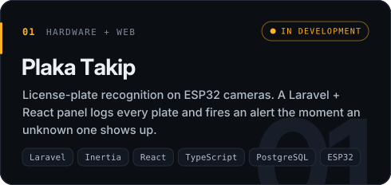
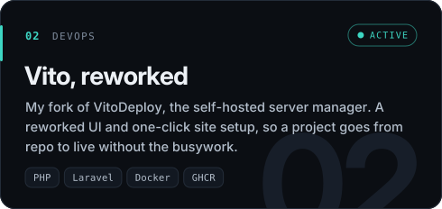
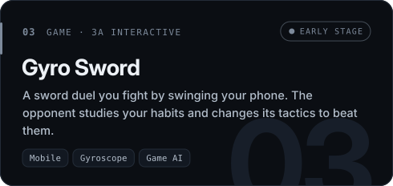
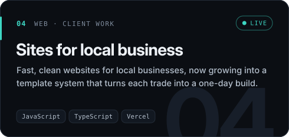
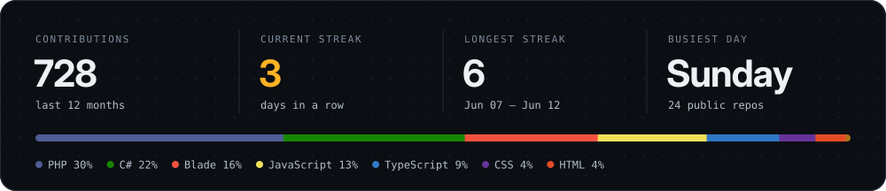
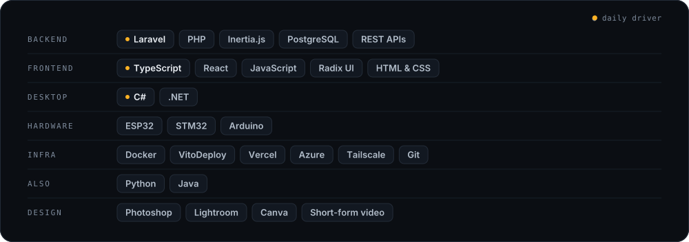

  <a href="https://www.linkedin.com/in/abd%C3%BCllatif-cengiz/"><b>LinkedIn</b></a> &nbsp;·&nbsp;
  <a href="https://www.youtube.com/@AbdullatifCengiz"><b>YouTube</b></a> &nbsp;·&nbsp;
  <a href="mailto:cengizabdullatif@gmail.com"><b>cengizabdullatif@gmail.com</b></a>

I'm Latif, a third-year software engineering student at Fırat University in Elazığ. Most of my code lives on the web: Laravel backends, TypeScript and React frontends, and the deploy tooling that ships them. The projects I like best are the ones that leave the browser — a camera that reads license plates, a phone that turns into a sword, a server that sets up a site in one click.

&nbsp;

### What I'm building

&nbsp;

### Elazığ, one commit at a time

Every building below is one week of my GitHub activity, rebuilt every night. Harput Castle keeps watch on the left.

&nbsp;

### Latest from the terminal

<!-- activity:start -->
- warming up — the bot fills this in on its first run.
<!-- activity:end -->

&nbsp;

### Toolbox

&nbsp;

### Shipped

| | Project | What it does |
|:--|:--|:--|
| Laravel | [workout-api](https://github.com/AbdullatifCengiz/workout-api) | REST API for logging workouts |
| Laravel | [library-app](https://github.com/AbdullatifCengiz/library-app) | Library management app |
| Laravel | [to-do-list-laravel](https://github.com/AbdullatifCengiz/to-do-list-laravel-) | Task manager |
| C# | [PersonelServisOtomasyonu](https://github.com/AbdullatifCengiz/PersonelServisOtomasyonu) | Staff shuttle service automation |
| C# | [Randevu_Sistemi](https://github.com/AbdullatifCengiz/Randevu_Sistemi) | Appointment booking system |
| C# | [Arac_Kullanimlari](https://github.com/AbdullatifCengiz/Arac_Kullanimlari) | Vehicle usage tracking |
| C# | [Notepad](https://github.com/AbdullatifCengiz/Notepad) · [flappy_bird](https://github.com/AbdullatifCengiz/flappy_bird) | A text editor and a Flappy Bird clone, built while learning C# |
| Web | [serdar-barut-web](https://github.com/AbdullatifCengiz/serdar-barut-web) · [web](https://github.com/AbdullatifCengiz/web) | Client and personal sites |

<b>Where it started</b> — first Java exercises, January 2025

 

[finalvizehesaplama](https://github.com/AbdullatifCengiz/finalvizehesaplama) · [final-vize-sinif-ortalamasi](https://github.com/AbdullatifCengiz/final-vize-sinif-ortalamasi) · [sayiya-kadar-toplama](https://github.com/AbdullatifCengiz/sayiya-kadar-toplama) · [faktoriyel-hesaplama](https://github.com/AbdullatifCengiz/faktoriyel-hesaplama) · [fibbonacci-dizisi](https://github.com/AbdullatifCengiz/fibbonacci-dizisi) · [ucgensel-sayi](https://github.com/AbdullatifCengiz/ucgensel-sayi) · [palindrom-sayi](https://github.com/AbdullatifCengiz/palindrom-sayi) · [sayi-tahmin](https://github.com/AbdullatifCengiz/sayi-tahmin) · [cark-cevirmece](https://github.com/AbdullatifCengiz/cark-cevirmece) · [tas-kagit-makas](https://github.com/AbdullatifCengiz/tas-kagit-makas) · [carpim-tablosu](https://github.com/AbdullatifCengiz/carpim-tablosu)

Kept public on purpose. Everyone starts with a factorial.

&nbsp;

### Off the keyboard

- R&D coordinator at **FÜBET**, Fırat University's IT & Education Community, where we turn ideas into TÜBİTAK projects
- I direct short-form videos for student communities and post on [YouTube](https://www.youtube.com/@AbdullatifCengiz)
- Always up for a halısaha match after a long build

&nbsp;

